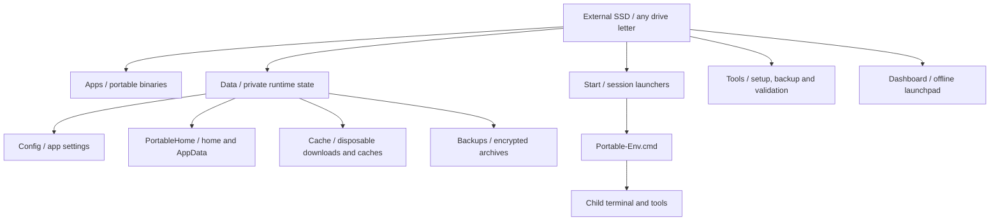

# Portable Dev Workstation

**Your entire development workspace. One external drive.**

[](https://github.com/fcflo151/portable-dev-workstation/actions/workflows/validate.yml)
[](LICENSE)

A clean, open-source starting point for a portable Windows development environment. Keep tools, configuration, caches and your portable home together on an external SSD, without installers, elevation or persistent environment-variable changes.

Created for [FLOLABS · Portable Workstation / Project 07](https://flolabs-web.web.app/projects/portable-workstation/).

> **Zero-admin by design. Minimized host footprint as a goal.** This template is not an OS sandbox and cannot guarantee zero traces: Windows, security software and individual apps may write host data. See [security and isolation](docs/SECURITY.md).

## What is included

- Drive-letter-independent batch launchers based on `%~dp0`.
- Session-local home, AppData, temporary directories and common tool caches.
- Optional, modular downloads of Portable Git, Node LTS and the 7-Zip standalone console.
- SHA-256 checks before downloaded executables run; existing tool folders are never overwritten.
- AES-256 7z backups with encrypted filenames, archive testing and an optional copy to an existing sync folder.
- A static offline dashboard with no dependencies or local server.
- Private runtime folders excluded from Git, MIT licensing, issue forms and Windows validation.

This is the public blueprint, not a copy of the private production workstation. Browser/OAuth routing, live process monitoring, cloud-provider authentication and silent backup scheduling are not included.

## Requirements

Windows 10 or 11 on x64, Windows PowerShell 5.1 or PowerShell 7, and a writable local SSD path. Use NTFS where possible. Bootstrap needs HTTPS access to GitHub and nodejs.org. Offline use is possible after provisioning. ARM64 tools must be installed manually; UNC roots are not supported by the batch terminal launcher.

No administrator rights are requested. Host execution policies, application control or organizational restrictions may still prevent use. Do not bypass your organization's policy.

## Quick start

1. Choose **Use this template → Create a new repository** on GitHub, then clone your new repository onto the SSD. Alternatively, download and extract the source ZIP. GitHub-generated repositories include the tracked template files, not installed tools or private data.
2. Double-click `Start\Start-Workstation.bat`. The terminal opens in the workstation root. Run all commands below inside that terminal.
3. Preview the optional setup, then install the tools you want:

   ```bat
   powershell.exe -NoProfile -File Tools\Setup-Workstation.ps1 -WhatIf
   powershell.exe -NoProfile -File Tools\Setup-Workstation.ps1
   ```

   For just one tool:

   ```bat
   powershell.exe -NoProfile -File Tools\Setup-Workstation.ps1 -Tools SevenZip
   ```

   To select several tools, open PowerShell in the workstation terminal and run:

   ```powershell
   .\Tools\Setup-Workstation.ps1 -Tools Git,Node
   ```

4. Configure **your own** identity inside the portable terminal:

   ```bat
   git config --global user.name "Your Name"
   git config --global user.email "you@example.com"
   git --version
   node --version
   7za
   ```

5. Optionally launch the dashboard:

   ```bat
   Start\Start-Workstation.bat --dashboard
   ```

   This uses the host's default browser, which may store history or other state on the host. For a portable browser, supply its explicit profile directory and open `Dashboard\index.html` manually.

If an internet-downloaded file is blocked, inspect it first and use `Unblock-File` on the specific trusted script if your policy permits. This project does not change the machine's execution policy.

## Chrome sign-in and privacy

**Expect to sign in again to Chrome and your websites whenever you switch to another PC or Windows account.** A portable profile does not make encrypted cookies, passwords or login sessions reliably portable. Windows encryption can bind them to the user, application or machine. On the same PC, sessions can persist; this template does not enforce a new login after every browser launch. Do not disable Windows/Chrome encryption to make logins travel. See [Google's explanation](https://security.googleblog.com/2024/07/improving-security-of-chrome-cookies-on.html).

Chrome is **not installed or configured by this public template**. If you add a portable Chrome, launch it with explicit SSD paths for `--user-data-dir` and `--disk-cache-dir`, configure its download directory on the SSD and verify **Profile Path** at `chrome://version`. Starting `chrome.exe` directly or opening the dashboard with `--dashboard` can use the host's browser/profile. [Chromium documents the profile override and verification](https://chromium.googlesource.com/chromium/src/+/main/docs/user_data_dir.md).

The maintainer's separate SSD installation was inspected before initial publication: its running Chrome used `Data\Browser` for its profile and `Data\Cache\Browser` for its disk cache. Cookies, history and login databases remained on the SSD after use. Its disconnect script removes temporary files and lock files; it does **not** wipe Chrome profiles, cookies or saved logins on either the SSD or host. A separate host Chrome profile also existed; the inspected files predated this check. That does not establish their origin or prove zero host writes.

The template has no automatic host-browser cleanup. Never delete a host owner's existing profile as a cleanup measure. Close the portable browser before disconnecting the drive; signing out is separate from deleting local data. Windows, crash reporting, downloads outside the configured directory and use of a host browser can still leave host traces. Browser profiles and credentials are excluded from publication; see [the browser privacy review](docs/BROWSER-PRIVACY.md).

## Architecture



```text
portable-dev-workstation/
├── Apps/                  # ignored portable tools; .gitkeep tracked
├── Data/
│   ├── Config/            # ignored app configuration; .gitkeep tracked
│   └── PortableHome/      # ignored HOME and AppData; .gitkeep tracked
├── Start/
│   ├── Portable-Env.cmd
│   └── Start-Workstation.bat
├── Tools/
│   ├── Setup-Workstation.ps1
│   ├── Backup-Workstation.ps1
│   ├── Workstation-Paths.ps1
│   ├── Test-Template.ps1
│   ├── Test-OnlineSetup.ps1
│   ├── Test-Repository.ps1
│   └── Test-RepositoryChecks.ps1
├── Dashboard/index.html
├── docs/
└── .github/
```

`Data\Cache`, `Data\Logs`, `Data\Backups` and home subdirectories are created at runtime. Your projects may live in `GitRepos\` (ignored by the workstation repository); keep each project in its own repository.

`Portable-Env.cmd` changes only the calling process. The launcher wraps it in `setlocal`, opens a child `cmd.exe /d /v:off` and restores its own environment on exit. To use it in another **cmd.exe** session, run `call Start\Portable-Env.cmd` with delayed expansion disabled. Calling a `.cmd` from an existing PowerShell process cannot change that parent PowerShell's environment; launch PowerShell from the portable terminal instead.

The setup installs into `Apps\Git`, `Apps\Node` and `Apps\7Zip`. Git and Node modules also download a small, hash-verified 7-Zip extraction helper into their disposable staging directory. Git's SFX executable is read as an archive; its required x64 post-install shell scripts then initialize the extracted payload before publication. Python is a manual slot at `Apps\Python`; it is not downloaded automatically. Existing tool folders are skipped. For upgrades, close all processes, make a backup and move the old folder aside manually before rerunning setup.

## Encrypted backups and recovery

From the portable terminal:

```bat
powershell.exe -NoProfile -File Tools\Backup-Workstation.ps1
```

The script asks for a **nonempty** password using a masked SecureString prompt. It publishes a `.7z` only after a successful archive test. Default sources are `Data\Config`, `Data\PortableHome` and `GitRepos` if present. `Temp`, `Cache`, `node_modules` and folder markers are excluded. Apps, workstation source files and sibling projects outside this root are not backed up by default. Close apps first: this is a file backup, not an application-consistent snapshot.

Use PowerShell array syntax for custom source directories:

```powershell
.\Tools\Backup-Workstation.ps1 -IncludePaths 'Data\Config','Data\PortableHome','GitRepos'
```

For repeat runs or a separate sync copy:

```powershell
$password = Read-Host 'Backup password' -AsSecureString
.\Tools\Backup-Workstation.ps1 -Password $password -SyncDirectory 'E:\EncryptedBackupSync'
```

`-Password` enables noninteractive invocation after a caller supplies a SecureString. In both modes, 7-Zip ultimately receives that password in its process arguments; another process with sufficient access may inspect it. Managed memory may also retain copies until garbage collection. Use only a trusted host. No password is saved, embedded in a script or written to logs. Quotes, NUL characters and line breaks are rejected for safe Windows argument handling. Do not use host-bound DPAPI secret files as a portable credential solution.

The sync directory must already exist. Only the verified encrypted archive is copied, followed by a SHA-256 comparison. A cloud client must be configured separately; copying does not prove remote upload. There is no deletion or retention policy. Keep a copy on another device: an archive on the same SSD does not protect against SSD failure.

To restore into a **new empty directory**, use the portable terminal:

```bat
7za t "E:\EncryptedBackupSync\workstation-example.7z" -p
7za x "E:\EncryptedBackupSync\workstation-example.7z" -p -o"E:\RestorePreview"
```

Inspect restored files before copying them into a working setup. Keep the password separately; losing it means losing access. Automate only after testing recovery. See [operations](docs/OPERATIONS.md) for session-based automation and release instructions.

## Contributing and validation

For future development sessions, start with [the development guide](docs/DEVELOPMENT.md), which records scope, constraints and validation commands.

See [the validation record](docs/VALIDATION.md) for tested scenarios, repairs and remaining limits.

```powershell
.\Tools\Test-Template.ps1 -SevenZipPath '.\Apps\7Zip\7za.exe' -RequireBackupTests
.\Tools\Test-Repository.ps1 -IncludeHistory
.\Tools\Test-RepositoryChecks.ps1
```

Validation checks PowerShell parsing, environment isolation and repeatability, paths with spaces, `&` and `!`, setup and backup dry-runs, encrypted backup restoration, encrypted headers, exclusions, sync-copy SHA-256 equality and source path boundaries. The test discovers portable 7-Zip under `Apps\7Zip` before looking for a host installation. Without a 7-Zip executable the backup checks are explicitly skipped unless `-RequireBackupTests` is supplied. CI requires them on Windows with PowerShell 5.1 and 7. This does not certify every app's portability or zero host writes.

The offline suite also exercises the actual terminal launcher and a Windows PowerShell child reached through `cmd.exe`, rejects missing or mismatched download hashes using synthetic responses, and checks invalid passwords, failed-archive cleanup and junction rejection. The repository check requires Git and checks working files, staged Git objects, expected private-path ignore rules and a limited set of credential patterns. `-IncludeHistory` additionally checks reachable history for the selected `-Revision` (default `HEAD`). CI fetches full history for this check. This does not detect arbitrary secrets.

To download, install and exercise all three tools in a disposable workstation on this drive:

```powershell
.\Tools\Test-OnlineSetup.ps1
```

Run this separately in PowerShell 5.1 and 7. It uses real upstream downloads, verifies repeat setup preserves binaries, creates a synthetic Git commit and clone, exercises Node/npm and runs the backup suite with the newly installed 7-Zip. Successful fixtures are deleted; `-KeepFailedFixture` retains a failed fixture for local diagnosis. In GitHub Actions, the manual **Run workflow** form exposes an opt-in online setup test for both shells. Ordinary pushes and pull requests run the offline checks.

Before publishing changes, inspect `git status`, `git diff --cached` and every tracked file. `.gitignore` cannot detect arbitrary secrets in source text or untrack existing files. Report vulnerabilities privately using the guidance in [SECURITY.md](docs/SECURITY.md); use the issue forms for sanitized bugs and feature proposals.

## License and upstream sources

The template is [MIT licensed](LICENSE). Downloaded tools retain their own licenses, included in their distributions. Binaries and private workstation data are not distributed here.

- [Portable Git releases](https://github.com/git-for-windows/git/releases) — Windows x64 self-extracting archive; release asset SHA-256 digest.
- [Node.js distributions](https://nodejs.org/dist/) — latest LTS x64 ZIP; matching `SHASUMS256.txt`.
- [7-Zip releases](https://github.com/ip7z/7zip/releases) — `7zr.exe` and the Extra archive; release asset SHA-256 digests. The x64 `7za.exe` standalone console supports encrypted 7z archives.

Checksums detect corrupt or mismatched downloads. Fetching a checksum from the same publisher is not independent signature verification. Versions are resolved on each setup run; pin and review upstream artifacts yourself when reproducible provisioning is required.
